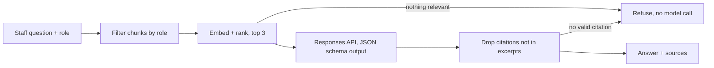

# Bank Policy Assistant

A small reference build for a common BFSI use case: branch and risk staff ask policy questions in plain language (English or Hinglish) and get short answers with citations, drawn only from policies their role is allowed to see.

It runs on the OpenAI API (Responses API with Structured Outputs, plus `text-embedding-3-small`) and comes with an evaluation suite, so model choice and prompt changes are measured rather than guessed.

> All policy documents in `docs/` are **fictional** ("Example Bank"). They are not RBI guidance or any real bank's policy.

## What it demonstrates

| Enterprise concern | How it is handled |
|---|---|
| Entitlements | Each document declares the groups that can read it. Retrieval filters by the caller's role **before** ranking, so restricted text never enters the prompt. |
| Grounding | The model answers only from the supplied excerpts and must cite excerpt ids. |
| Hallucinated sources | Citations are checked against the excerpts actually supplied. An answer left with no valid citation is replaced by a refusal. |
| Out-of-scope questions | Nothing relevant retrieved means a refusal with no model call. Otherwise the model is told to refuse rather than guess. |
| Prompt injection via documents | Excerpts are framed as data, not instructions. |
| Cost vs quality | A cheap model (`gpt-6-luna`) answers and a stronger model (`gpt-6.1-sol`) grades. The evals show whether the cheap model is good enough. |
| Regression safety | `evals.py` exits non-zero on any failure, so it can gate CI. |



## Run it

```bash
pip install -r requirements.txt
```

Set `OPENAI_API_KEY` in your environment, then:

```bash
python app.py --role branch "Customer wants to close a fixed-rate personal loan after 8 months. What is the charge?"
```

```bash
python app.py --role branch "What is the transaction amount above which suspected fraud must go to FRMU?"
```

The second question refuses for `branch` and answers for `--role risk`.

## Evaluate

```bash
python evals.py
```

This runs 16 cases from `evals.jsonl` and writes `eval_report.md`:

- **10 answerable questions.** Each must cite the right section, include key facts (amounts, days, roles) and pass an LLM-judge groundedness check. One question is in Hinglish.
- **2 out-of-scope questions.** These must refuse.
- **2 access tests.** Branch staff ask about the restricted fraud procedure and must get a refusal, with no restricted chunk retrieved.
- **2 positive access tests.** Risk staff ask the same questions and must get cited answers.

Compare models with `ANSWER_MODEL=gpt-6.1-sol python evals.py`. Retrieval misses and generation failures are reported separately, so you can tell which layer to fix.

`python test_offline.py` checks the guardrails without an API key, using a fake client.

## Taking it to production

- **Identity:** take the role from SSO group claims (Entra ID, WSO2 Identity Server, Okta), not a CLI flag.
- **Retrieval at scale:** move to OpenAI vector stores with `file_search` and attribute filters for entitlements. Keep the same evals.
- **Audit:** log question, role, retrieved ids, citations and model version for every answer.
- **Human review:** sample refusals and low-confidence answers weekly, and turn real failures into new eval cases.
- **Change control:** re-run evals on every policy update and every model change.
